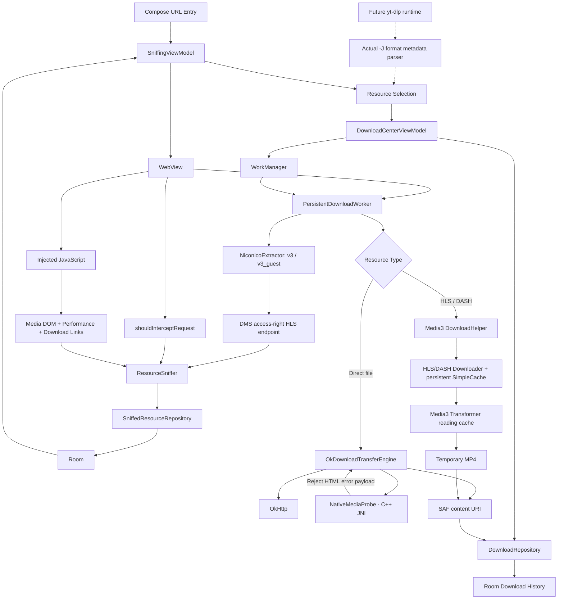

# Architecture

## Runtime data flow

## Package responsibilities

- `presentation.sniffing`: sniffing screen state and WebView callbacks.
- `presentation.downloads`: DataStore output-folder state and Room-backed download history.
- `data.network`: OkDownload adapter, using the app's shared OkHttp configuration.
- `data.media`: Media3 DownloadHelper track selection, persistent HLS/DASH segment cache, resumable segment download and Transformer export.
- `data.extractor.NiconicoExtractor` + `NiconicoApiParser`: request Niconico's current watch API and DMS HLS access-right endpoint, reusing only the active WebView session cookie where applicable. Temporary manifest URLs remain in memory and are refreshed by the worker before transfer.
- `NiconicoUrlParser`: accepts canonical Niconico watch URLs and official `nico.ms` short links; rejects lookalike domains and live-stream IDs.
- `data.extractor.YtDlpInfoJsonParser`: pure JSON boundary for future yt-dlp `-J` output. It extracts actual format metadata, excludes DRM formats from selectable lists, builds safe format selectors and intentionally never retains signed media URLs or request headers. This parser is not yet wired to a yt-dlp execution runtime or UI.
- `data.local`: Room entities, DAOs and database.
- `data.preferences`: DataStore preferences.
- `data.repository`: repository interfaces and implementations.
- `di`: Hilt bindings for network, storage and repositories.
- `ResourceClassifier.java`: platform-independent classification for media, playlists, documents, archives, application packages, fonts, code/data and generic files; Kotlin maps Java enum names into app state.
- `FileNameSanitizer.java`: shared filename normalization used by resource discovery and download saving.
- `NativeMediaProbe.kt` + `app/src/main/cpp`: C++17/JNI byte-signature inspection; it is not a decoder and does not replace Media3.
- `tools/validate_media_fixtures.py`: Python validation of local HLS/DASH fixtures and the native signature detector.

## Design constraints

1. UI code calls ViewModels; it does not own database/network work.
2. ViewModels expose observable state with Kotlin Flow.
3. WorkManager persists job scheduling and runs downloads in a foreground worker.
4. Room is the durable app-facing download history; OkDownload's breakpoint store is the transport-level resume metadata for direct downloads. Live WorkManager progress carries transferred bytes, total bytes and speed when known.
5. On Android 10+, downloads are published through the public MediaStore Download collection by default; a user-granted SAF tree URI is an optional override. Android 9 and earlier require a SAF destination.
6. Adaptive streams are exported through Media3, not manually concatenated by app code.
7. Credentials are not uploaded. The shared OkHttp network interceptor asks Android CookieManager for cookies scoped to each exact request URL, including redirected requests; cookie values are never persisted or logged.
