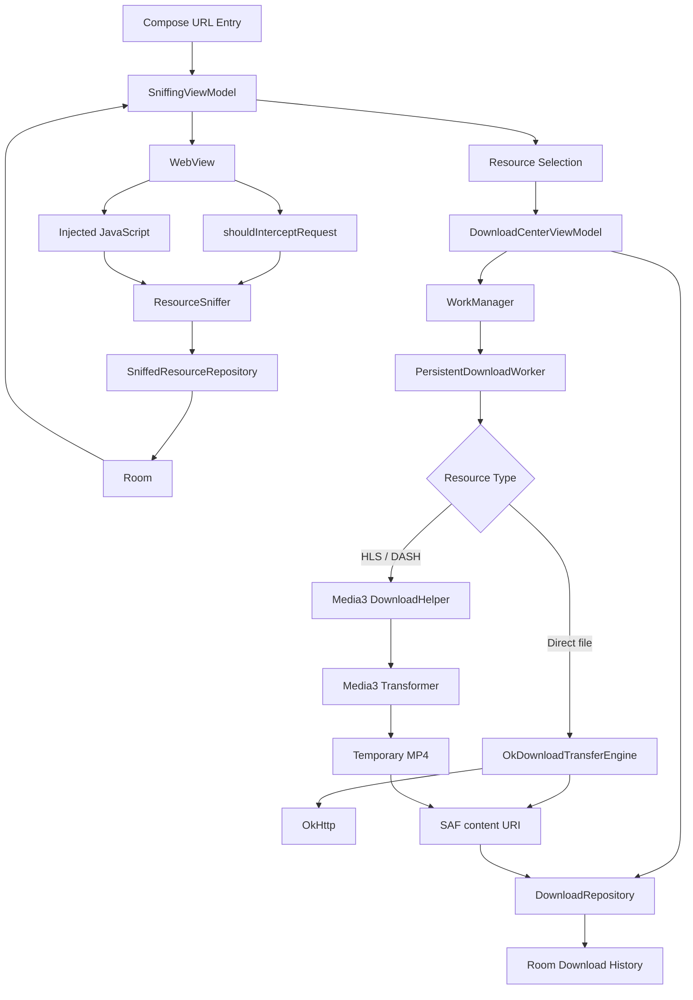

# Architecture

## Runtime data flow

## Package responsibilities

- `presentation.sniffing`: sniffing screen state and WebView callbacks.
- `presentation.downloads`: DataStore output-folder state and Room-backed download history.
- `data.network`: OkDownload adapter, using the app's shared OkHttp configuration.
- `data.media`: Media3 DownloadHelper track preparation and Transformer export.
- `data.local`: Room entities, DAOs and database.
- `data.preferences`: DataStore preferences.
- `data.repository`: repository interfaces and implementations.
- `di`: Hilt bindings for network, storage and repositories.

## Design constraints

1. UI code calls ViewModels; it does not own database/network work.
2. ViewModels expose observable state with Kotlin Flow.
3. WorkManager persists job scheduling and runs downloads in a foreground worker.
4. Room is the durable app-facing download history; OkDownload's breakpoint store is the transport-level resume metadata for direct downloads.
5. All output files are created through the user-granted SAF tree URI.
6. Adaptive streams are exported through Media3, not manually concatenated by app code.
7. Credentials are not uploaded. WebView cookies are not currently bridged into downloader requests.
